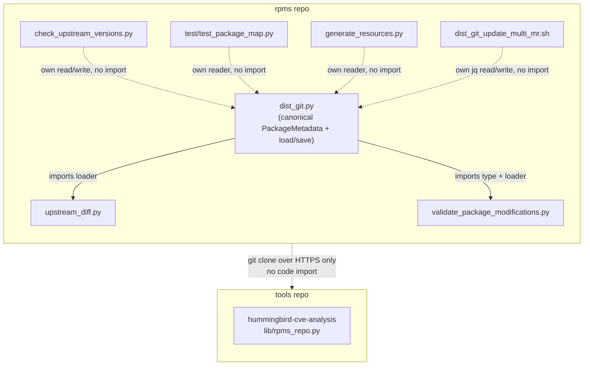

# Reviewer's Note

This document is for the purposes of review only and will not be merged as-is in this
repository; hence the DNM and draft status. It tries to show the thought process and
propose changes that largely impact this repository. But assuming folks are generally
happy with this PR, I will create an ADR for this which will be published elsewhere.

# Executive Summary

Research for [HUM-6231](https://redhat.atlassian.net/browse/HUM-6231) found nine scripts across the
`rpms` and `tools` repos independently reimplementing the same metadata logic.  This has already cause
data drift as observed in the Fedora 44 rebuild.  As such, we should build a canonical Python "library"
in `rpms` that owns this logic. This will prevent drift and regressions in our data.  This library
should not only include common functions shared by the scripts, but it should also centralize rpm metadata
manipulation even if the function is not shared.

# Background

We are working on an [HUM-5584](https://redhat.atlassian.net/browse/HUM-5584), which is an EPIC that
tracks an issue we had with the Fedora 44 rebase for Hummingbird. The gist of the EPIC is that many
of the foundational fields in our metadata.json files inside `rpms/metadata` we being misused and
quite possibly mistaken. Much of this surrounded the various states as Hummingbird became more
mature. When the rebuild for F44 occurred, there was no denying the technical debt that had
occurred. HUM-5584 was created to track that.

After the team discussed the various fields and what their purposes were, we began to document this.
We documented how these things should work together and how both the versioning of RPMs should be
done depending on the RPMs state and what the metadata should look like accordingly. This
information was compiled into an ADR/specification which was tracked by
[HUM-6212](https://redhat.atlassian.net/browse/HUM-6212). The spec was written an aspirational and
as such, reflects what we want the metadata to do from here on (which it does not yet). HUM-6212
also has a link to the MR for the spec, but it can also be found in `../documentation` from the
current CWD.

What needs to occur now is the follow-on work now that a specification has been defined. This work
will focus more on the metadata and its tools rather than RPM versioning. This is what this document
is meant for and shall be used to feed various AI activities and prompting.

# [HUM-6231](https://redhat.atlassian.net/browse/HUM-6231)

At this point, we need to do some research to ascertain a deeper understanding of:

* what interacts with the metadata (like dist_git.py) and in what ways.  Let's get those listed.
* would a common library, python module, or simply some Python code in this repo help drive
  consistency in our data?
* if so, which scripts would be, can we begin to think about an "API-like" approach where this
  code is completely insulated from scripts.

I would like to gather questions and answers in an organized manner in the `Findings` section below.
I would like to perform this interactively. Once findings and research is done, I would like to
interactively draw conclusions which will be eventually made into recommendations or a plan for
HUM-6231.

# Findings

To answer HUM-6231's research questions, we:

* Started from the consumers HUM-6231 already names, reading each to see which fields it
  reads/writes, how it accesses the file, and whether it has inline logic resembling ADR-0003.
* Broadened the search across both `rpms` and `tools` via grep — for `metadata/`, for specific
  field names, and across test files, bash/shell scripts, and Konflux/Tekton templates.
* Manually verified every hit, because a plain grep for "metadata" also catches false positives
  (e.g. `createrepo`, Kubernetes `metadata:` blocks, a Postgres column named `metadata`).

This produced a complete, verified consumer list, rather than relying on the ticket's own
list.

## Consumers of `metadata/<package>.json`

A full sweep of `rpms` and `tools` (Python scripts, bash/jq scripts, and Konflux/Tekton `.j2`
templates) turned up **nine real consumers** of `metadata/<package>.json` — more than the four named
in HUM-6231's own description. Here we also discover that multiple implementations and
re-implementations exist in our scripts, and they are sometimes even in the same `rpms` repository.

| # | Consumer | Repo | R/W | Access pattern | Notes |
| --- | --- | --- | --- | --- | --- |
| 1 | `ci/dist_git.py` | rpms | R/W | Typed `PackageMetadata` TypedDict + `load_/save_package_metadata()` | Canonical loader/saver, but `modification_status` state-transition logic is scattered across 6+ call sites in the same file rather than centralized. Still uses the old flat schema (`source`/`branch`/`sha`/`release`) — no `fedora` nested object anywhere. |
| 2 | `ci/check_upstream_versions.py` | rpms | R/W | Raw untyped `json.load`/`json.dump`; **own independent loader** (`get_package_metadata()`) and a separate raw read/write pair inside `mark_package_modified()` | Does not call dist_git's helpers despite living in the same directory. Silently swallows `JSONDecodeError`/`OSError` and just logs + returns. |
| 3 | `ci/validate_package_modifications.py` | rpms | R | Imports `PackageMetadata`/`load_package_metadata`/`is_package_unmodified` from `dist_git`, but also does its own raw `json.load` | Contains its own ~7-rule validation set that overlaps but doesn't map 1:1 to the ADR's 23 validation rules, and checks the old flat schema (`source`/`branch`/`sha`) rather than `fedora.*`. |
| 4 | `ci/upstream_diff.py` | rpms | R | Reuses `dist_git.load_package_metadata()` | Cleanest consumer — no independently reimplemented logic. |
| 5 | `ci/split_import_json.py` | rpms | W | Raw `json.load`/`json.dump`, schema-agnostic passthrough | One-time migration tool; no field-level knowledge, so nothing to validate. |
| 6 | `test/test_package_map.py` | rpms | R | Own `_load_metadata()` (raw `json.load`) | CI-enforced via `make check` (per repo CLAUDE.md). Checks only `upstream_repo` presence/non-emptiness — a fifth independent implementation of a rule that overlaps ADR rule 3 and `validate_package_modifications.py`'s check 3. |
| 7 | `ci/generate_resources.py` | rpms | R | `load_yaml_file()` — i.e. `yaml.safe_load()` on a `.json` file, not `json.load()` | Reads `modification_status` and `source` (old flat schema) to decide independent-vs-Fedora-tracked pipeline shape. Different failure mode than the rest of the codebase (`yaml.YAMLError` vs `json.JSONDecodeError`) for the exact same file type. |
| 8 | `ci/dist_git_update_multi_mr.sh` | rpms | R/W | Raw `jq` | Reads `.modification_status // "clean"` with its own inline default to filter packages; on merge-conflict recovery, writes metadata back via `jq '.metadata' .dist_git_update_state.json > "metadata/${package}.json"` (re-serializing a value `dist_git.py update` already computed, not new business logic, but still a non-Python touchpoint with its own assumptions). |
| 9 | `hummingbird-cve-analysis/hummingbird_cve_analysis/lib/rpms_repo.py` | tools | R | Raw `json.loads()`, no shared contract with `rpms` at all — clones the whole `rpms` repo via git rather than importing anything | Reads `upstream_repo`, `upstream_branch`, `cve_product`, `version_transform`, `fix_status`. Has its **own** normalization helpers (`_normalize_cve_product_value()`, `_normalize_fix_status()`) that defensively coerce malformed values `rpms` has no equivalent validation for — i.e. more field-level rigor exists downstream than at the source of truth. Also has a CSV-based fallback loader, treating `metadata/*.json` as just one of two interchangeable data sources. |

## Functional Requirements for Current Consumers

### Common functions across consumers

Looking across the nine consumers by *functional requirement* rather than by script shows the same
handful of capabilities needed repeatedly, each of which is currently reimplemented independently
instead of shared:

| Functional requirement | Who needs it | Current state | Consistency risk |
| --- | --- | --- | --- |
| Load `metadata/<package>.json` | All 9 consumers | 5+ independent implementations: dist_git's typed loader, check_upstream_versions's untyped loader (plus a *second*, separate raw read inside `mark_package_modified`), test_package_map's own raw loader, generate_resources's `yaml.safe_load()`, tools' raw cross-repo `json.loads()`, and `dist_git_update_multi_mr.sh`'s `jq` reads | Different error behavior per implementation (`JSONDecodeError` vs `YAMLError` vs silently swallowed); no single source of truth for "how do you read this file." |
| Write `metadata/<package>.json` | dist_git.py, check_upstream_versions.py, split_import_json.py, dist_git_update_multi_mr.sh | 4 independent write paths, only one of which (dist_git's) is typed | A write from any non-canonical path can produce a file none of the others expect. |
| Determine/apply `modification_status` (state model: `clean`/`modified`/`independent`) | dist_git.py, check_upstream_versions.py, validate_package_modifications.py, test_package_map.py, generate_resources.py, dist_git_update_multi_mr.sh | Reimplemented in 6+ places, including a bash `jq` default (`// "clean"`) that has no Python equivalent to stay in sync with | The single most-referenced piece of business logic in the whole system has no single owner. |
| Validate field presence/shape rules (e.g. "`upstream_repo` must be set," "`fedora` required when `modified`") | validate_package_modifications.py, test_package_map.py | 2 independently-written rule sets, neither fully aligned with each other or with the ADR's 23 validation rules | Silent gaps — a rule enforced in one place may not be enforced in the other; ADR rules 11–14, 22–23 (the `fedora`-object rules) are enforced nowhere. |
| Normalize/coerce field values (`cve_product`, `fix_status`) | hummingbird-cve-analysis (tools) | Implemented only downstream, in the repo that *consumes* the data, not the one that produces it | Malformed values can be written at the source and only get caught (or silently coerced) far away, in a different repo. |
| Translate old flat schema ↔ ADR's nested `fedora` schema | Nobody yet — but every consumer will need this once migration starts | Not implemented anywhere | Every one of the 9 consumers reads/writes the pre-ADR flat schema (`source`/`branch`/`sha`/`release`) today; a library built against the ADR's target shape has no current implementation to migrate incrementally against, so consumers would need to adopt the new schema and the library together, or the library would need to support both schemas during a transition. |

### Centralization of Logic Area

The functional-requirements table above is organized by *duplication evidence* (how many places
already reimplement something). This section asks a different question for each logic area:
independent of how many callers exist today, does this belong in one central place as a matter of
what it is? A single current caller does not disqualify something from belonging centrally if the
logic is inherently part of the metadata contract rather than a script-specific concern.

The following table describes a minimum recommended set of functions that could be implemented to single-source
the altering of metadata.

| Logic | Current callers | Why it belongs centrally |
| --- | --- | --- |
| Release/NVR computation (`bump_release()`, dist_git.py:1096-1135) | 1 (only `rebuild`) | A direct implementation of the ADR's "Computing the built NVR" algorithm — pure spec logic, not CLI plumbing. It already diverges from the ADR: it reads the top-level `release` field the ADR says must not exist (rule 7), and branches on `'source' in metadata` rather than on which of the ADR's three states applies, so it can apply a stored base value even in the "ahead of Fedora" case where the ADR says none should exist. This is the exact bug shape HUM-5182 traces back to. |
| Canonical "package universe" | 5 independent implementations | Not simple duplication — three genuinely different definitions were invented ad hoc: packages with a `.spec` file (check_upstream_versions), packages with a metadata file (dist_git), and manifest ∪ directory (generate_resources). `validate_package_modifications.py` had to write a live drift-detector (`find_packages_without_metadata()`) because these sets can disagree. The fix is naming these as distinct, centrally-owned concepts rather than letting a sixth script invent a fourth definition. |
| `modification_status` state transitions | 6 sites in `dist_git.py` alone | The same state model, written 6 separate times, with real divergence: the import path picks `independent` vs `clean` from a URL substring match — a heuristic that appears nowhere in the ADR — while `update` unconditionally overwrites flat `release` regardless of state. Only `mark_modified` cleanly satisfies ADR rules 15/16. A single state-transition function that atomically sets status + `modification_reason` + release-related fields together would make the other 5 sites' bugs structurally impossible. |
| ADR's 23 validation rules specifically | 2 independent, non-identical rule sets | The ADR itself says "a validator can implement each line as a direct check." `validate_package_modifications.py` and `test_package_map.py` don't share a rule-checker — rule 3 (`upstream_repo` present) is enforced by exactly one of the two. Carve-out: several of `validate_package_modifications.py`'s checks (Konflux-override policy, changelog/Release-format policy, git-history cross-check) aren't derived from the ADR at all and should stay local, layered on top of a shared ADR-rule-checker rather than folded into it. |
| `cve_product`/`fix_status` normalization | 1 (only `tools/hummingbird-cve-analysis`) | The strongest "centralize even though only one caller has it" case. The normalization logic *is* the real validation spec for these fields — it just lives downstream of where the data is authored. `rpms/ci` has a type annotation and zero runtime enforcement. Centralizing it and calling it from `dist_git.py` on write would catch bad data at the source instead of silently coercing it two repos away. |

## Current Code-Sharing Precedent and Gaps

The `validate_package_modifications.py` and `upstream_diff.py` scripts already import directly
from `dist_git.py` (`PackageMetadata`, `load_package_metadata`, `is_package_unmodified`,
`METADATA_DIR`) via `sys.path` manipulation, which proves that in-repo code sharing already works
mechanically. The gap is that `check_upstream_versions.py`, `test_package_map.py`,
`generate_resources.py`, and `dist_git_update_multi_mr.sh` don't use it despite living in the same
repo, and that nothing bridges `rpms` and `tools`, because `tools` clones the whole `rpms` git repo
over HTTPS rather than importing any of its code.

The following illustration attempts to depict the current relationship of various tools
dealing with metadata:

Solid arrows are real code imports; dashed arrows are independent reimplementations with no shared
code at all. Within `rpms`, sharing already works for 2 of 6 same-repo consumers — the mechanism
exists, it's just inconsistently adopted. Across the `rpms` → `tools` boundary there is no
mechanism at all: `tools` treats `rpms` purely as a git checkout to read files from, not as a
dependency to import code from.

# Conclusions

## Summary

Creating a canonical Python library for `metadata/<package>.json` is appropriate.
Centralizing the logic of dealing with metadata will prevent the kind of regressions that
plagued the Fedora 44 rebuild and tooling. The `rpms` repo is the right home for it. The library
itself can be built and merged on its own, but wiring up consumers has to happen together with the
metadata schema migration, in a single coordinated effort — not staged consumer by consumer —
because a partial migration would leave some consumers reading a schema that no longer matches
what's on disk.

## Canonical Python Library

The findings show that `metadata/<package>.json` is read and written by 9 separate
consumers across 2 repositories, with the same handful of capabilities — reading and writing the
file, tracking `modification_status`, computing the next `Release:` value, validating field
rules, and normalizing a couple of specific fields — reimplemented independently rather than
shared. Some of that duplication has already caused observable drift (divergent definitions of
"all packages," inconsistent handling of `modification_status` transitions). Other cases have
only one implementation today but are clear candidates for centralizing anyway, because the logic
is part of the metadata contract itself rather than something specific to the script that happens
to contain it today.

Given that, a shared Python library is worth building. It should not be scoped as "just load and
save" — the evidence points to a broader contract.

### Functional requirements of a library

The following list of functions should be the core of any new code created.

* Load and save `metadata/<package>.json`.
* Offer explicit function calls for consumers to transition a package between states, rather than
  each consumer mutating `modification_status` and related fields by hand. This covers both the
  transitions already implemented today, scattered across `dist_git.py` and
  `check_upstream_versions.py`, and the transitions the ADR describes but no tool currently
  performs.
* Compute the next `Release:` value per the ADR's NVR rules (`bump_release`), corrected to key off
  actual package state rather than the current `'source' in metadata` check.
* Validate metadata against the ADR's 23 rules in one place.
* Name the small number of legitimately distinct "package universe" definitions (has-a-spec-file,
  has-a-metadata-file, in-target-manifest) instead of leaving each script to invent its own.
* Normalize `cve_product`/`fix_status`, moving that logic to where the data is authored instead of
  where it's defensively consumed.
* Expose all of the above through properties rather than raw dict access, so that the eventual
  flat-schema-to-nested-`fedora` migration is an internal change to the library, not a rewrite of
  every consumer.

## Establish library in rpms repo

The `rpms` repo is the natural home for this library, because 8 of the 9 consumers already live
there and two of them already import directly from `dist_git.py`. The one open question the
research doesn't resolve on its own is how the 9th consumer, `hummingbird-cve-analysis` in the
`tools` repo, should reach it — the `tools` repo currently clones `rpms` wholesale rather than
depending on any of its code.  And then decide whether to keep that pattern, formalize it, or publish
the library as an installable package is a separate decision this document doesn't need to make
yet.

## Recommended process

This splits into two phases instead of a gradual per-consumer rollout. The library itself doesn't touch
the on-disk file format, so it can be built and merged independently. But once any consumer starts
being wired to expect the ADR's target schema, every consumer has to make that jump together —
otherwise some tools would be reading a schema that no longer matches what's actually on disk.

**Phase 1 — build the library, standalone:**

1. Extract the existing canonical metadata code already in `dist_git.py`
   (`PackageMetadata`, `load_package_metadata`, `save_package_metadata`, and related logic) into
   its own library module, generalized and hardened per the functional requirements above rather
   than copied as-is.
2. Add the additional API calls the functional requirements call for but don't yet exist anywhere
   (the central validator, the state-transition function, the package-universe helpers, etc.).
3. Write tests for the library and get it reviewed and merged on its own — wired into nothing yet,
   and the on-disk metadata format is untouched.

**Phase 2 — migrate the schema and every consumer together:**

1. In one coordinated effort, migrate every `metadata/*.json` file to the ADR's target schema
   (flat `source`/`branch`/`sha`/`release` → nested `fedora`) and wire up all 9 consumers, in both
   `rpms` and `tools`, to use the library. These two things happen together because they depend on
   each other: the schema flip is only safe once every consumer is going through the library
   instead of raw field access, and there's no reason to wire consumers to the library ahead of the
   schema flip it exists to insulate them from.

# Unresolved Questions

1. **How should the `tools` repo reach the library?** `hummingbird-cve-analysis` is one of the 9
   consumers that needs to be migrated in Phase 2, but `tools` currently clones `rpms` wholesale
   over HTTPS rather than depending on any of its code. Options include keeping that pattern and
   importing from the clone, formalizing `rpms` (or just the library) as an installable package, or
   a new dedicated repo/package for just the metadata contract. This needs to be resolved before
   Phase 2 starts.
2. **Is the team OK with a library that never exposes the raw dict?** The design direction above
   assumes consumers interact with metadata only through functions, getters, and setters the
   library provides, never through the underlying dict directly. That's a real constraint on how
   every consumer is written, not just an implementation detail, and needs buy-in before Phase 1
   starts.

# Out of Scope

We have identified some items during discovery that require attention but perhaps fall out of scope
for this effort. These could be created as stories and completed behind this effort.

## Canonical-source principle

Ideally, the library becomes the canonical source for every core alteration to
`metadata/<package>.json` — the single place that decides what changes are made, not just one
option among several. We are not proposing a CI check to enforce that: Python has no
compiler-enforced equivalent of Go's exported/unexported distinction, so ordinary naming
convention plus code review is enough to catch a bypass. The one standing exception is
`dist_git_update_multi_mr.sh`'s conflict-recovery step, which writes `metadata/<package>.json`
directly via `jq` — but it only flushes to disk a value `dist_git.py` already computed and staged
in a state file; it never decides metadata content itself, so it doesn't undermine the
canonical-source principle even though the physical write happens outside Python.

## Bash/jq read-side drift

That same script also reads `modification_status` via `jq -r '.modification_status // "clean"'`,
with its own hardcoded fallback that could silently drift from whatever default the library uses.
The fix is a small `dist_git.py` subcommand that prints metadata (or a single field) to stdout, so
the script queries through it instead of reimplementing the default itself.
