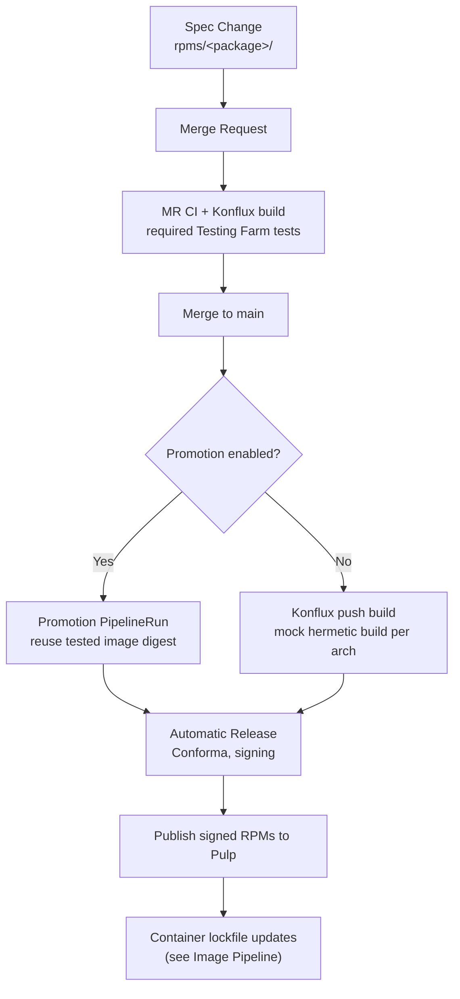

Explanation of the RPM build pipeline, from spec file changes through
validation, building, signing, and publishing to the Hummingbird package
repository.

## Overview

The RPM pipeline consists of five main stages:

1. **Spec Change** - A package spec file is modified in `rpms/<package>/`
2. **MR Build & Validation** - Konflux builds RPMs and required tests validate them before merge
3. **Promotion or Push Build** - After merge, packages reuse the tested MR image by default;
   explicit build exceptions build again on `main`
4. **Release & Signing** - Integration Service creates the Release; the managed pipeline checks
   Conforma and signs the RPMs
5. **Publishing** - Signed RPMs are uploaded to the Hummingbird Pulp repository

After publishing, updated RPMs are picked up by the [container image
pipeline][image-pipeline] via lockfile updates.

[image-pipeline]: https://hummingbird-project.io/l/image-pipeline



## Stage 1: Spec Change

An RPM change begins as a commit in `rpms/<package>/`. The change typically
includes a modified `.spec` file (updated version, new patch, or Release bump)
and any associated source files or patches.

### How changes originate

| Method                     | Description                                                            | Modification Status         |
| -------------------------- | ---------------------------------------------------------------------- | --------------------------- |
| Automated Fedora sync      | `ci/dist_git.py update` merges upstream Fedora changes                 | No `independent` packages   |
| Upstream version update    | `ci/check_upstream_versions.py --update` bumps to new upstream release | No `independent` packages   |
| Manual patch backport      | Developer adds a CVE patch and references it in the `.spec`            | Marked `modified` afterward |
| No-change rebuild          | `ci/dist_git.py rebuild <package>` bumps the Release field             | Status unchanged            |
| Reverse dependency rebuild | `ci/dist_git.py rebuild-rev-deps <package>` rebuilds all dependents    | Status unchanged            |

See [Rebuilding Packages][rebuilding] and [Updating Dist-git
Packages][updating] for detailed workflows.

[rebuilding]: https://hummingbird-project.io/l/rebuilding-packages
[updating]: https://hummingbird-project.io/l/updating-dist-git-packages

### Package metadata

Each package has a metadata file at `metadata/<package>.json` that tracks its
relationship to upstream:

```json
{
  "source": "https://src.fedoraproject.org/rpms/curl.git",
  "branch": "rawhide",
  "sha": "abc123...",
  "version": "8.12.1",
  "release": "1",
  "modification_status": "clean",
  "upstream_repo": "https://github.com/curl/curl"
}
```

Key fields:

| Field                 | Purpose                                                                                                                        |
| --------------------- | ------------------------------------------------------------------------------------------------------------------------------ |
| `modification_status` | `clean` (auto-updates enabled), `modified` (auto-updates blocked), or `independent` (no upstream)                              |
| `modification_reason` | Explanation of local modifications (when `modified`)                                                                           |
| `release`             | Fedora release at last import/update (not the spec `Release:`), without dist tag; present only while shipping Fedora's release |
| `upstream_repo`       | Canonical upstream git repository URL                                                                                          |
| `track_upstream`      | Version prefix constraint (e.g., `"1.26"` for golang1.26)                                                                      |
| `version_transform`   | Version mapping rule for CVE analysis (e.g., `dotnet_sdk_to_runtime`)                                                          |
| `cve_product`         | CVE vendor/product override (string, or a list for multiple products; e.g. `"Oracle Corporation / Oracle Java SE"`)            |

See [Package Metadata Fields][metadata-fields] for `modification_status` and `release`
configuration, and [Package Modification Tracking][mod-tracking] for managing modification
status day to day.

[metadata-fields]: https://hummingbird-project.io/l/package-metadata-fields
[mod-tracking]: https://hummingbird-project.io/l/package-modification-tracking

## Stage 2: Merge Request & Validation

Changes reach main via merge requests. Automated MRs are created using:

- **`ci/create_mr.sh`** - Single MR with configurable options
- **`ci/rebuild_multi_mr.sh`** - One MR per package with auto-merge enabled
- **`ci/dist_git_update_multi_mr.sh`** - Automated Fedora update MRs (scheduled CI job)
- **`ci/upstream_update_multi_mr.sh`** - Automated upstream version update MRs (scheduled CI job)

The scheduled upstream-version update job creates normal MRs for successful package updates. If a
package update fails after a new version has been identified, it creates (or reuses) a draft
diagnostic MR instead. The diagnostic MR includes the original error but no partial package
changes, and must be resolved manually before a package update can be proposed.

Both scheduled update jobs send a Slack completion message when `SLACK_WEBHOOK_URL` is configured:
success sends a plain success message, including when upstream warnings were logged, while failure
includes actionable package failures and links to MRs needing attention. Routine upstream warnings
remain in the job log and summary, not in Slack.

These completion messages also act as a heartbeat. The notification runs in the job's `after_script`,
so a job that never starts, or a runner failure before `after_script` can run, may send no message.
A missing expected message is a signal to check the schedule and runner availability; it is not an
automatic missed-run alert.

### CI validation

GitLab CI runs validation jobs on every merge request:

- **`check`** - Linting, type checking, and spec validation
- **`check_nevr_conflicts`** - Predicts the NEVR(A) each changed package's
  spec would build (using `rpmspec` with the real dist-tag macros, without
  actually building) and checks it against the public Pulp repo. Catches the
  case where a Konflux build succeeds and the MR merges, but the resulting
  NEVR was already published (typically two independent Release bumps based
  on stale `main`, e.g. two `rebuild` MRs), which fails the post-merge
  build+sign+publish pipeline since Pulp treats each NEVRA as unique and
  immutable. Only scheduled for MRs that touch `rpms/**/*`, and within that,
  only checks packages whose `rpms/<package>/` directory itself changed --
  matching Konflux's own build trigger -- not packages whose only change is
  under `metadata/`, since a metadata-only change (e.g.
  `ci/dist_git.py mark-modified`) never causes a rebuild/republish. Run
  locally with `make check-nevr-conflicts ARGS='<package>'`, or against real
  built RPMs with
  `make check-nevr-conflicts ARGS='--rpms-dir builds/<package>'` after
  `ci/build_rpms.sh`. See `ci/check_nevr_conflicts.py`'s module docstring for
  full details. Known limitations: only the public signed Pulp domain is
  checked (packages routed to a `private_product` are noted but not fully
  verified, since their domains require Pulp API credentials this tool
  doesn't have); and since it reflects Pulp's state at job-run time, it
  reduces but cannot fully close the race where another MR publishes the
  same NEVR between this check passing and this MR's eventual merge -- only
  a hard check inside the actual Konflux publish pipeline (a separate
  pipeline-bundle repository, `quay.io/hummingbird-ci/rpmbuild-pipeline`,
  not covered by this job) could close that window completely; and in spec
  mode some `OK` results can be for a package name a real build never
  actually produces (e.g. a base package with no top-level `%files`
  section, roughly 14% of packages in this repo) -- expected and harmless,
  and never a reason to discount a `CONFLICT` found elsewhere in the same
  run.
- **`tree_status`** - Repository consistency checks (metadata integrity, spec
  file presence)
- **Testing Farm** - Integration tests run via an IntegrationTestScenario that
  exercises built RPMs on a real RHEL compose (see [Testing](#testing) below)

### Auto-approval for chore MRs

Automated update MRs (`chore/*` branches) follow an accelerated path:

1. MR is created with auto-merge enabled
2. Konflux builds the package and posts commit statuses
3. After a delay, the `chore_mr_approval` CI job auto-approves the MR
4. GitLab merges the MR once the pipeline succeeds

## Stage 3: Promotion or Push Build

Konflux builds RPMs for merge requests. After merge, packages use
[MR Artifact Promotion](../operating/mr-artifact-promotion.md) to release that tested image by
default. Packages explicitly configured with `push_pipeline: build` build again on `main`.

### Build triggers

Each package has a Tekton MR build PipelineRun definition generated from its directory in
`rpms/<package>/` (see [`.tekton/rpms-on-pull-request.yaml.j2`][pr-template] and the rendered
[`.tekton/rpms-on-pull-request.yaml`][pr-pipeline]). [PipelinesAsCode][pac] triggers it for MR
changes. A push to `main` triggers one PipelineRun per affected package: a promotion run from
`.tekton/rpms-on-promotion.yaml` by default, or a build from `.tekton/rpms-on-push.yaml` for an
explicit `push_pipeline: build` exception.

The `setup` package acts as a canary: changes to `ci/` or `mock/` directories
also trigger a `setup` build on pull requests, validating build infrastructure
changes before they reach main.

[pac]: https://pipelinesascode.com/
[pr-template]: https://gitlab.com/redhat/hummingbird/rpms/-/blob/main/.tekton/rpms-on-pull-request.yaml.j2
[pr-pipeline]: https://gitlab.com/redhat/hummingbird/rpms/-/blob/main/.tekton/rpms-on-pull-request.yaml

### Build process

The build pipeline (`build-rpm-package`) executes for each target
architecture:

1. Checks out the repository at the MR head or push commit
2. Calculates build dependencies
3. Runs `mock` in **hermetic mode** (network-isolated with pre-fetched
   dependencies)
4. Produces RPM artifacts and build logs
5. Generates an SBOM (Software Bill of Materials)
6. Stores artifacts as Trusted Artifacts in the Konflux OCI registry

### Build architectures

Packages are built for the architectures specified in their PipelineRun
definition. Packages build for x86_64, aarch64, and s390x by default. Per-package
overrides can select other architectures or build platforms.

### Build output

Build artifacts are stored in the Konflux OCI registry:

```text
quay.io/redhat-user-workloads/hummingbird-tenant/<package>--main
```

### Konflux resources

Build infrastructure is defined across two repositories:

- **rpms repo** (`konflux-templates/`) - Per-package Component and
  ImageRepository resources, ReleasePlanAdmission, EnterpriseContractPolicy,
  IntegrationTestScenario
- **infrastructure repo** (`kubernetes/rpms-main/`) - Application,
  ReleasePlan, ServiceAccount, and Secret resources

See [Konflux Resource Deployment][konflux-deploy] for details on how these
resources are managed and deployed.

[konflux-deploy]: konflux-resource-deployment.md

### Testing

RPM packages are validated through integration tests that run on Testing Farm
infrastructure.

Tests run via [Testing Farm][testing-farm] on RHEL-9-Nightly systems for both
`x86_64` and `aarch64` architectures. Test results appear as external jobs in
GitLab CI pipelines, providing pass/fail status and links to the Konflux
PipelineRun.

[testing-farm]: https://docs.testing-farm.io/

#### Test triggering

Tests are only triggered on merge requests, not on main branch builds. For a
package at `rpms/<package>/`, tests are triggered for all changes below that
directory.

#### Integration Test Scenario

Tests are triggered via an `IntegrationTestScenario` resource generated by this
(rpms) repository:

**Configuration**: `konflux-templates/scenarios.yml` (application × template matrix) and
`konflux-templates/scenarios/<type>.yml.j2` (full CR content per scenario type); both consumed
by the generator for CR rendering and manifest emission  
**Rendered output**: `konflux-templates/rendered.yml`  
**Deploy path**: via the `*-releases` infrastructure sync on merge to main (not the
components sync — ITS is static repo-level config not intended to change in MRs; concurrent
MR pipelines would otherwise reset the live CR). Renovate `IMAGE_TAG` bumps auto-deploy on
merge via the same path.

The scenario uses the upstream [Testing Farm pipeline for Konflux
CI][integrations-konflux] and is parameterized as follows:

[integrations-konflux]: https://gitlab.com/testing-farm/integrations-konflux

The generator emits two scenario types per application (instantiated from templates in
`konflux-templates/scenarios/`):

- **`testing-farm`** (non-optional, `pull_request` context) — runs on every pre-merge
  component snapshot. Parameters:
  - `COMPOSE: RHEL-9-Nightly` - Test environment OS/compose
  - `PIPELINE_MODE: rpm` - Configures RPM testing mode (vs. container)
  - `ARCH: x86_64,aarch64` - Architectures to test (creates separate test runs per arch)
  - `PASS_SNAPSHOT_TO_TF: false` - Don't pass full snapshot JSON (package info comes via
    `IMAGE_NAME`/`IMAGE_URL` instead)
  - `IMAGE_TAG:` - Version of the tmt-via-testing-farm pipeline bundle
  - `GIT_URL:` - Allowlisted upstream repo URL (public `rpms-main` application only; omitted
    for private applications)

- **`testing-farm-upstream`** (optional, `component_attr-main` + `component_setup-main`
  canary contexts) — runs only on canary component snapshots. Additional parameter:
  - `TMT_PATH_FROM_CONTEXT: "true"` - Derives the tmt test path from the component context

**Key characteristics**:

- **Single scenario per application** - Not per-package; runs for every package build in
  that application
- **Context-based triggering** - `testing-farm` runs on `pull_request` snapshots only;
  `testing-farm-upstream` runs on canary component snapshots and is optional (not listed in
  the [trigger manifest](https://hummingbird-project.io/l/trigger-manifests))
- **Package identification** - Konflux automatically provides `IMAGE_NAME` (e.g., `openssl-main`)
  and `IMAGE_URL` (OCI image with built RPMs) as environment variables

#### FMF test plan

The root folder of the `rpms` repository is marked with a `.fmf` directory to
identify it as an FMF metadata tree for tmt. The test plan in
`ci/run_tests_rpm.fmf` sets up the test instance and runs default and
package-specific tests via `ci/run_tests_rpm.sh`.

#### Test environment

These environment variables are available to the tmt test execution:

| Variable      | Description                                                             |
| ------------- | ----------------------------------------------------------------------- |
| `IMAGE_NAME`  | Component name (e.g., `openssl-main`)                                   |
| `IMAGE_URL`   | OCI image URL with built RPMs (e.g., `quay.io/.../openssl-main@sha...`) |
| `SNAPSHOT`    | Snapshot metadata (if `PASS_SNAPSHOT_TO_TF` is true)                    |
| `COMPOSE`     | OS/compose being tested (`RHEL-9-Nightly`)                              |
| `ARCH`        | Architectures being tested (`x86_64,aarch64`)                           |
| `TMT_VERSION` | tmt version running the tests                                           |

## Stage 4: Release and Signing

Integration Service creates an automatic Release for a passing push Component Snapshot. For an MR
artifact promotion, the Snapshot reuses the tested digest and does not run the MR tests again.
Release Service validates Conforma and signs the RPMs before publishing:

- **Method**: Kerberos-based signing via
  `konflux-release-signing-prod@IPA.REDHAT.COM`
- **Pipeline**: Signing runs as part of the release pipeline, before the Pulp
  upload step
- **Signing image**: `quay.io/konflux-ci/signing:latest` _(verify pinned
  digest in ReleasePlanAdmission)_

## Stage 5: Publishing to Pulp

After signing, RPMs are uploaded to the Hummingbird Pulp repository.

### Release pipeline

The `push-rpms-to-pulp` release pipeline handles the upload. Configuration is
defined in the ReleasePlanAdmission resource
(`releng/hummingbird-rpms-tech-preview-staging.yaml`):

```yaml
mapping:
  rpm-repositories:
    - name: x86_64
      repository_id: public-hummingbird-x86_64-rpms
    - name: aarch64
      repository_id: public-hummingbird-aarch64-rpms
    - name: src
      repository_id: public-hummingbird-source-rpms
    # See ReleasePlanAdmission for the full list of published architectures
```

### Pulp repository

Published RPMs are available in the
[Pulp content index](https://packages.redhat.com/api/pulp-content/public-hummingbird/):

Pulp automatically regenerates repository metadata (repodata) after each
upload, making new packages immediately resolvable by DNF/YUM clients.

## What Happens Next

Once RPMs are available in Pulp, the [container image pipeline][image-pipeline]
picks them up via lockfile updates. See the [Image Pipeline][image-pipeline]
documentation in the containers repo for the full container lifecycle.

## Related Documentation

- [MR Artifact Promotion](../operating/mr-artifact-promotion.md) - Current path that releases a
  tested MR image without a push rebuild
- [Rebuilding Packages][rebuilding] - No-change rebuilds, reverse dependency
  rebuilds, and patch backports
- [Updating Dist-git Packages][updating] - Automated Fedora sync workflow
- [Package Metadata Fields][metadata-fields] - `modification_status` and
  `release` configuration
- [Package Modification Tracking][mod-tracking] - Managing modification status
  and version constraints
- [Konflux Resource Deployment][konflux-deploy] - How Konflux resources are
  defined and deployed
- [Image Pipeline][image-pipeline] - Container image pipeline (continues from
  where this document ends)
